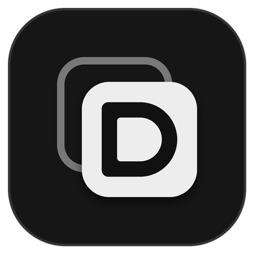

<p align="center">
  
</p>

<h1 align="center">Discord Quest Decoy</h1>

Make Discord see a game that isn't actually running, so "play this game" Quests can progress without installing the game.

Discord Quest Decoy is a small, portable Windows app. You pick a game from Discord's own list of detectable games, press **Play**, and a tiny stand-in program is started under that game's executable name. Discord's game detection picks it up, and your profile shows the game as being played.

> **Please read the [Disclaimer](#disclaimer) before using this software.**

## Features

- Search Discord's detectable game list and keep your own **My games** list
- One click to start and stop a stand-in for the selected game
- Game list is refreshed from Discord at startup, with a built-in copy as a fallback
- Optional `extra-games.txt` adds more games, shown with a `[custom]` tag
- Dark interface with a settings screen (language, list updates, folders)
- Translations are plain JSON files, so adding a language needs no code
- Portable: everything lives in the app's own folder, nothing is written elsewhere
- No Discord login, token or account access of any kind

## Download

1. Open the [Releases](../../releases) page and download the latest `.zip`.
2. Extract it anywhere you can write to (Desktop, Documents, a USB drive, ...).
   Avoid folders like `C:\Program Files`, where the app can't create its `data` folder.
3. Run `DiscordQuestDecoy.exe`.

Requires Windows 10 or 11 (64-bit). No installer and no .NET runtime needed.

Windows SmartScreen may warn about an unsigned app on first launch. Choose **More info → Run anyway** if you trust the download.

## Folder layout

```
discord-quest-decoy/
├─ DiscordQuestDecoy.exe
├─ extra-games.txt       optional extra games (see below)
├─ languages/            translation files (add your own here)
│  ├─ en.json
│  └─ tr.json
└─ data/                 created on first launch
   ├─ settings.json      your settings and My games list
   ├─ gamelist.json      cached game list
   ├─ games/             stand-in programs created by the app
   └─ log.txt            troubleshooting log
```

To uninstall, close the app and delete the folder.

## How to use

1. Open the Discord **desktop** app and accept the Quest you want to complete.
2. Make sure Discord's game activity sharing is enabled (User Settings → Activity Privacy).
3. In Discord Quest Decoy, search for the game in the top bar and press **+ Add**.
4. Select the game in **My games**. If it lists several executables, pick one.
5. Press **Play**. A small window opens: leave it open.
6. Check that your Discord profile shows the game as being played.
7. Keep it running until the Quest finishes (for most Quests, around 15 minutes), then press **Stop**.

If a game doesn't register, stop it and try another executable from the list.

The files inside `data/games/` are the stand-in programs the app creates. If you open one by hand it only shows its small window, it does not start the app again.

## Limitations

- Windows only.
- Only helps with Quests that ask you to **play a game on desktop**. It does nothing for video, stream or activity Quests.
- It relies on how Discord currently detects games. Discord can change that at any time, and the tool may stop working without notice.
- Only games on Discord's detectable list (and the ones you add in `extra-games.txt`) are available, and only those with a Windows executable.

## Privacy

The app collects nothing and sends nothing about you anywhere. Its only network request is downloading Discord's public game list at startup, which you can turn off in Settings. To get new versions, watch the repository's releases on GitHub.

## Extra games

`extra-games.txt` (next to the exe) lets you add games that are missing from Discord's list. Each game is a block: the name on one line, then one executable path per line. Blank lines separate games and lines starting with `#` are comments.

```
Mozilla Firefox
..\Mozilla Firefox\firefox.exe

Some Game
..\Some Game\bin\game.exe
..\Some Game\launcher.exe
```

- A leading `..\` is ignored and both `\` and `/` work.
- Only paths ending in `.exe` are used, anything else is skipped.
- These games appear in the search with a `[custom]` tag. Open the file from Settings > Open extra games file, and the list reloads when you close Settings.
- The file is optional. If it is missing or has mistakes, the app still works.
- Whether Discord recognises one of these paths is up to Discord. Some entries may not count towards a Quest.

## Adding a language

1. Copy `languages/en.json` to `languages/<code>.json` (for example `de.json`).
2. Set `_name` to the language's display name and translate the values. Leave the keys unchanged.
3. Open Settings and choose the new language. Missing keys fall back to English.

Pull requests with new translations are welcome.

## Building from source

You need the [.NET 8 SDK](https://dotnet.microsoft.com/download).

```
dotnet publish src/DiscordQuestDecoy/DiscordQuestDecoy.csproj -c Release -r win-x64 --self-contained true -p:PublishSingleFile=true -o publish
```

Releases are built automatically by GitHub Actions: pushing a tag such as `v1.0.0` produces a zip on the Releases page.

```
git tag v1.0.0
git push origin v1.0.0
```

## Disclaimer

**Educational and personal use only.** This project exists to explore how Discord's game detection works. It is not meant to cheat anyone out of anything, and you should not rely on it for anything important.

**No affiliation.** Discord Quest Decoy is an independent hobby project. It is not made, approved or supported by Discord Inc., by any game developer or publisher, or by any advertiser. "Discord" is a trademark of Discord Inc. The name is used here only to describe what the tool works with, and it does not suggest any partnership or endorsement.

**You may be breaking the rules.** Quests are funded by sponsors who want real players to try their games. Completing them with software that imitates gameplay can violate Discord's Terms of Service and Community Guidelines. Possible outcomes include losing Quest rewards, account warnings, temporary suspension, or a permanent ban. Please consider whether it is worth that risk, and play the games when you can.

**No warranty.** The software is provided "as is", without any warranty, express or implied. There is no promise that it is safe, accurate, up to date, or that it will keep working.

**No liability.** To the fullest extent permitted by law, the authors and contributors are not responsible for any claim, damage, lost account, lost reward, or other consequence that comes from using, misusing, or being unable to use this software.

**Your responsibility.** You decide whether to run it, and you accept whatever follows. If you do not agree with these terms, do not download or run this software.

If a rights holder has a concern about this project, please open an issue so it can be addressed.

## License

[MIT](LICENSE)

## Acknowledgements

Inspired by the idea behind [markterence/discord-quest-completer](https://github.com/markterence/discord-quest-completer). This project is a separate, from-scratch implementation.
